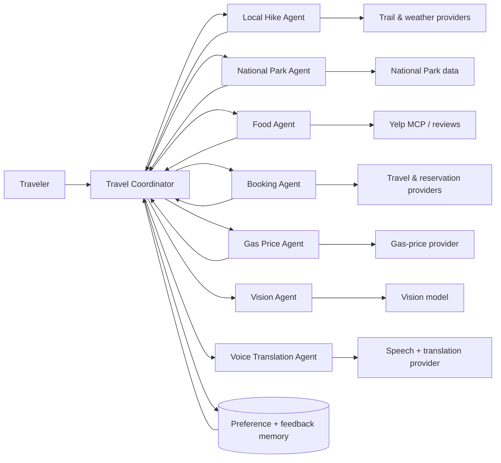

# Roamwise architecture

The coordinator delegates independent searches, ranks results against the
traveler profile and recent activities, and asks for explicit confirmation
before any reservation or purchase.
